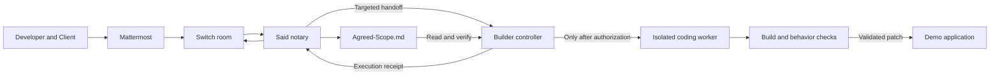

# Said — Detailed Engineering and Hackathon Plan

## 1. Goal, scope, and verified technical baseline

Build **Said**, a consent gatekeeper for Switch rooms:

> A request becomes a draft. Work starts only after two designated people accept the same version. When someone disputes the agreement, Said shows the exact terms and approval receipts.

The main demonstration is a client requesting dark mode, a developer accepting it, the client later disputing its absence, and execution beginning only after the client also accepts.

This document is the implementation plan. Coding, installation, account configuration, and publishing happen later.

### Intended deliverables

- A functioning business workflow using Switch and local Mattermost.
- A personal workflow using the same consent engine.
- A deterministic notary service.
- A builder controller that enforces authorization before launching a coding agent.
- Switch Template v2 configurations.
- A Vite/React demonstration application.
- Automated state-machine, integration, and browser tests.
- Setup, reset, diagnostic, and demonstration scripts.
- README, architecture documentation, blog draft, demo script, and submission checklist.

The proposed implementation location is `/Users/atharvraotole/Desktop/said-switch`.

### Corrections to the supplied specification

These changes are necessary to make the project technically defensible.

| Original assumption | Verified reality | Planning decision |
|---|---|---|
| Switch v0.31.0 is the target | The release tag is `switch-v0.31.0`, commit `7e57cd433a922bc91a00150c106e6ef1f15b1057` | Pin the initial integration to this release and record tested Console/runtime versions separately. |
| Prompt instructions can enforce consent | A coding agent with write tools can violate a prompt-only rule | Put the authorization check in a separate deterministic controller that decides whether the coding process starts. |
| Room Documents are tamper-proof | Agent updates are creator-restricted, but humans can delete documents through the room UI; updates lack a revision precondition | Describe them as server-stored, author-restricted documents. Add signed receipts, one writer per room, and fail-closed recovery. |
| A template can seed the canonical ledger | A template-created document is not necessarily owned by Said | Said creates `Agreed-Scope.md` after joining the room. |
| `!follow-ups on` guarantees next-day, unmentioned replies | Follow-ups depend on conversation context and configuration; they are not an unrestricted permanent listener | The custom Said client receives room events and applies its own narrow intent routing. Follow-ups remain a convenience feature. |
| `switch-trust scan` certifies the React change | The scanner targets supported Python agent frameworks, not arbitrary React/TypeScript | Report frontend checks and agent-security scans separately. Never label an unsupported scan “clean.” |
| A fresh installation takes three minutes | Docker downloads, account setup, and provider authentication can exceed this | Target three minutes for an already-prepared environment; measure cold setup separately. |
| Twenty-five commits are an official requirement | That requirement was not established by the official event material | Use 25 meaningful milestones as an engineering roadmap, without manufactured timestamps or empty commits. |

These conclusions come from the [pinned template reference](https://github.com/sandbox-quantum/switch/blob/switch-v0.31.0/docs/TEMPLATES.md), [pinned document and messaging operations](https://github.com/sandbox-quantum/switch/blob/switch-v0.31.0/core/switch_core/bridges/agent/operations/definitions.py), [Switch connection documentation](https://docs.switchagents.ai/switch-rooms/internals/agent-connection), and [Switch Trust scan documentation](https://docs.switchagents.ai/switch-trust-cli/scan/getting-started).

### Scope priorities

**Required for the first complete release**

- Business dark-mode scenario.
- Personal agreement/dispute scenario.
- All consent and identity protections.
- Real Switch persistence and messaging.
- Actual gated code generation.
- Reproducible setup and automated tests.
- Honest reporting of unavailable integrations.

**Included after the main workflow works**

- Optional isolated execution room.
- Wispr usage evidence and recording instructions.
- Blog and submission materials.

**Deferred**

- Calendar writes.
- Voice-transcript ingestion.
- Production deployments.
- Payments or billing.
- Multi-tenant hosting.
- High-availability notary replicas.
- Autonomous GitHub issue claiming or submission.

The first release is a workflow authorization tool, not an electronic-signature or legal-contract platform.

---

## 2. Architecture and authorization model

### Components

| Component | Responsibility | Explicit boundary |
|---|---|---|
| Mattermost | Two distinct human accounts and visible conversation | Display names do not establish identity. |
| Switch | Authenticated events, addressing policy, rooms, documents, targeted handoffs | Application consent rules remain Said’s responsibility. |
| Said notary | Parse requests and approvals, maintain the ledger, issue authorization receipts | No general shell or application-editing capability. |
| Builder controller | Independently verify authorization, manage jobs, validate and apply changes | A chat message alone never authorizes execution. |
| Coding worker | Implement the accepted scope in an isolated working copy | Receives accepted terms, not the raw client transcript. |
| Demo application | Show the observable result | Starts genuinely light-only. |
| Verification tools | Check application behavior, dependencies, and eligible agent code | Report coverage and failures explicitly. |



### Implementation choices

- **Backend:** Python 3.12+, `asyncio`, typed data models, HTTP client, WebSocket client, and Ed25519 signing.
- **Notary:** Custom Switch protocol client, rather than a general coding agent with a restrictive prompt.
- **Builder:** Custom Switch controller wrapping a noninteractive Codex worker.
- **Frontend:** React, TypeScript, and Vite.
- **Tests:** `pytest` for backend behavior and Playwright for browser behavior.
- **Storage:** Switch Room Documents are authoritative in live mode. Local files hold only configuration, operational checkpoints, job artifacts, and explicitly labeled test fixtures.
- **Dependency management:** Python and Node lockfiles committed during implementation.
- **Model selection:** Explicit runtime configuration; no hardcoded dependency on a particular paid model.

Codex supports noninteractive execution, workspace-write sandboxing, and JSON event output. The controller will use those capabilities without disabling the sandbox. [Official OpenAI documentation](https://learn.chatgpt.com/docs/non-interactive-mode)

### Why Switch is central

The live workflow depends on Switch for:

1. The authenticated message stream from both people.
2. Server-enforced addressing restrictions.
3. The canonical shared agreement document.
4. Agent-to-agent handoff.
5. Visible execution receipts in the same collaboration environment.

If Switch becomes unavailable, the live application must stop authorizing new work. An offline test harness may exercise the state machine, but it must never silently replace the live authority.

### Identity enrollment

The two parties are configured before accepting agreements.

Store:

- Switch deployment identifier.
- Room ID.
- Exact, opaque sender ID for each party.
- Friendly display label.
- Expected Said and builder identities.

Enrollment procedure:

1. Both users join the intended Mattermost channel.
2. Each posts a unique enrollment phrase.
3. The setup tool displays the authenticated sender IDs received through Switch.
4. The operator binds each sender ID to its role.
5. Reject enrollment if the two IDs are identical.
6. Lock the mapping for that room’s ledger.

Never infer identity from `@Developer`, message text, a display name, or an alleged third-party approval. Treat Switch participant IDs as opaque values. [Switch event documentation](https://docs.switchagents.ai/switch-rooms/internals/agent-events)

Changing a party requires a new room configuration and explicit re-enrollment; it must not reinterpret existing approvals.

### Addressing configuration

- Said: `anyone`.
- Builder: `owner-agents`.
- Builder’s own controller additionally requires a valid Said authorization.

The second check matters because `owner-agents` also permits the owner and other agents belonging to that owner. It is not a consent check by itself.

For custom-agent API configuration, distinguish the API value `owner_and_owner_agents` from the template shorthand `owner-agents`. Confirm the effective policy after registration rather than relying on defaults. [Switch addressing documentation](https://docs.switchagents.ai/switch-rooms/internals/identity-and-access)

### Same-room and isolated-room operation

**Default demo configuration:** Said and the builder controller are visible in the business room. The coding worker does not receive room history.

**Optional isolation configuration:**

- Client room: developer, client, Said.
- Build room: developer, Said, builder.
- Said publishes a signed execution manifest into the build room.
- Builder verifies that manifest and requests fresh authorization from Said before starting and applying changes.
- Builder is not granted membership in the client room.

A room link alone does not grant access to the source room’s documents.

---

## 3. Agreement model and deterministic behavior

### Canonical ledger

`Agreed-Scope.md` contains:

1. Human-readable accepted agreements.
2. Pending drafts.
3. Rejected and superseded revisions.
4. Execution status and evidence.
5. A versioned machine-readable payload.
6. A notary signature over the canonical payload.

The human-readable sections are rendered from the machine payload. They are never parsed independently as a second source of truth.

### Required data

| Record | Required fields |
|---|---|
| Ledger | Schema version, deployment ID, room ID, parties, revision, update time, drafts, agreements, processed event IDs |
| Draft | Draft ID, version, scope, terms, terms hash, proposer receipt, status, approvals, revision history |
| Approval receipt | Exact sender ID, message ID, server timestamp, original message text, draft ID, version, terms hash |
| Agreement | Agreement ID, source draft/version, locked terms, both approval receipts, lock time |
| Execution | Job ID, agreement hash, base commit, status, attempt number, changed paths, verification results, resulting commit |
| Signed envelope | Payload digest, key ID, signature, ledger revision |

Use canonical JSON serialization and SHA-256 for terms and payload hashes. Use Ed25519 for the notary’s attestation.

These are **notary attestations of authenticated messages**, not personal cryptographic signatures generated by the humans.

The signing key belongs to the notary service and is never supplied to a language model or coding worker. The builder receives only the pinned verification key.

### State transitions

**Agreement state**

- `NEEDS_TERMS`
- `PENDING`
- `LOCKED`
- `REJECTED`
- `SUPERSEDED`
- `CANCELLED`

**Execution state**

- `NOT_AUTHORIZED`
- `READY`
- `RUNNING`
- `VALIDATING`
- `APPLY_AUTHORIZED`
- `COMPLETED`
- `FAILED`
- `PAUSED`
- `CANCELLED`

Keep agreement state separate from execution state. Failed implementation does not erase mutual acceptance.

### Request and approval syntax

Provide a small deterministic command language:

| Intent | Example |
|---|---|
| Propose | `Propose: Add dark mode | Terms: +2 days, +$400` |
| Accept | `Accept DRF-002 v1` |
| Revise | `Revise DRF-002: Add dark mode | Terms: +1 day, +$400` |
| Withdraw approval | `Withdraw DRF-002 v1` |
| Reject | `Reject DRF-002 v1` |
| Request cancellation | `Cancel AGR-002` |
| Ask status | `Status DRF-002` |
| Ask for evidence | `What did we agree about dark mode?` |

Allow a limited set of conversational equivalents, such as “Fine, I accept DRF-002,” through explicit parsing rules.

Do not accept:

- Conditional approval: “I accept if…”
- Negation: “I don’t accept…”
- Quoted approval.
- Someone else’s reported approval.
- Approval buried in pasted instructions.
- A model’s interpretation that the user “probably agreed.”

### Natural-language requests

Natural language may create a draft, but never grant execution authority.

For the demo:

- Recognize the specified dark-mode request.
- Recognize CSV export as a second draft scenario.
- Recognize the personal movie/errand scenario.
- Treat “I thought we agreed” and related phrases as evidence requests.

An optional model-based extractor can later propose structured scope and terms. Its output passes schema validation and enters the same unapproved draft flow.

Missing commercial terms remain `NEEDS_TERMS`. Said must not invent a price or deadline. The demonstration’s “+2 days, +$400” terms come from a clearly configured demo policy or an explicit developer proposal.

### Acceptance rules

1. Only a configured party may approve.
2. A proposal does not count as approval.
3. Both approvals must reference identical terms and revision.
4. Every revision invalidates both existing approvals.
5. Revised drafts require an explicit version in subsequent approval messages.
6. An unqualified “Yes, I accept” is allowed only when exactly one eligible, unrevised draft exists and there is no conflicting reference.
7. Duplicate messages do not create duplicate approvals.
8. Withdrawals affect only the sender’s approval before lock.
9. Locked terms are immutable; amendments create new drafts.

This deliberately tightens the original counterproposal example: proposing revised terms does not automatically sign them.

### Cancellation and emergency stops

- Before lock: either person may withdraw their approval.
- After lock: cancellation requires a separate bilaterally approved cancellation draft.
- Before application: an approved cancellation prevents promotion of the patch.
- During generation: cancellation stops the worker and retains diagnostic artifacts.
- After `APPLY_AUTHORIZED`: cancellation becomes a new reversal request; it cannot pretend already-applied work never happened.
- The developer may pause execution immediately for operational safety. Pausing does not cancel the agreement or fabricate the other person’s consent.

### Dispute responses

Generate dispute responses from stored records, without asking a model to reconstruct history.

Each response includes:

- Agreement or draft ID.
- Exact scope and terms.
- Exact approval timestamps.
- Who approved and who did not.
- Current execution status.
- Original message references where available.

If no matching agreement exists, say so. If several records match, present their IDs and request a selection.

### Persistence and recovery

Switch document updates do not provide a compare-and-swap revision argument. The release therefore uses **one notary writer per room**, not active-active replicas.

Processing sequence:

1. Receive and authenticate the Switch event.
2. Check room and sender.
3. Deduplicate the message.
4. Calculate a proposed state transition.
5. Increment the ledger revision.
6. Sign and update the canonical document.
7. Read it back and verify the exact digest.
8. Only then acknowledge acceptance or dispatch work.

If a write times out, read back before retrying. A timeout does not prove the write failed.

If the document is missing, malformed, unexpectedly replaced, or has an invalid signature:

- Stop authorization.
- Preserve evidence.
- Report the problem.
- Require deliberate recovery.
- Never recreate an empty ledger and continue as if nothing happened.

Before reaching the document size limit, stop accepting new drafts and require an explicitly planned archive/rotation. Do not silently truncate history.

---

## 4. Switch integration and builder execution

### Switch adapter contract

Implement a small adapter around the pinned protocol.

| Capability | Verified interface |
|---|---|
| Register custom agent | `POST /agents` with a registration credential |
| Discover operations | `GET /agents/{agent_id}/ops` |
| Invoke operation | `POST /agents/{agent_id}/ops/{operation}` |
| Bind operations to connection | `X-Switch-Connection-Id` header |
| Receive events | Authenticated WebSocket connection |
| Read room context | `connect_to_room`, `read_context` |
| Read ledger | `load_internal_documents(ids)` |
| Create ledger | `create_room_document(name, description, instructions, content)` |
| Update ledger | `update_room_document(document_id, content=...)` |
| Post ordinary response | `post_message(body, thread_id)` |
| Handoff | `send_targeted_message(body, target_names, thread_id)` |

Operation arguments are sent directly in the JSON body. The connected room supplies context for operations that do not accept `room_id`. Inspect each target’s handoff status; `not_permitted` must not be treated as successful execution. [Pinned operation definitions](https://github.com/sandbox-quantum/switch/blob/switch-v0.31.0/core/switch_core/bridges/agent/operations/definitions.py)

Do not use legacy task delegation endpoints.

### Connection behavior

- Persist a connection UUID and last fully processed event cursor.
- Answer heartbeat pings independently of ledger processing.
- Advance the cursor only after durable processing.
- Reconnect with bounded exponential backoff.
- Stop on authentication failure, incompatible protocol, or takeover.
- On a replay gap, reconcile against room history and the signed ledger before resuming.
- If complete reconstruction cannot be established, remain paused.

Use separate connection contexts for separate rooms so an operation cannot accidentally target the wrong room.

### Builder authorization

A targeted message is a notification, not an execution permit.

Before launching a worker, the builder must:

1. Confirm the message came from the configured Said identity.
2. Load the authoritative document or signed isolated-room manifest.
3. Verify the notary signature and configured room identity.
4. Verify both human approvals, revision, and terms hash.
5. Check the agreement is locked and not cancelled.
6. Check the job has not already completed.
7. Verify the intended repository and base commit.
8. Obtain a fresh start authorization from the notary.

Use a stable job key derived from deployment, room, agreement, version, and terms hash.

### Worker isolation

The controller creates a disposable copy of the demo application after authorization.

The worker receives:

- Accepted scope.
- Accepted constraints.
- Current application source.
- Allowed output paths.
- Required acceptance checks.

It does not receive:

- Raw client conversation.
- Notary signing keys.
- Switch administration credentials.
- Production credentials.
- Permission to modify the controller or canonical ledger.

For the dark-mode job, allow modifications only to:

- `src/App.tsx`
- `src/styles.css`

Changing dependencies, package scripts, configuration, symlinks, binary files, or unrelated paths fails validation.

Run the coding worker with workspace-write restrictions inside the isolated environment. Never interpolate chat text into shell commands.

### Applying the result

1. Generate the patch in the disposable copy.
2. Inspect changed paths and file types.
3. Run TypeScript, production build, and browser checks.
4. Run dependency/security checks with clear coverage.
5. Confirm the original application still matches the expected base.
6. Ask the notary for fresh apply authorization.
7. Record `APPLY_AUTHORIZED` as the serialized decision point.
8. Apply the validated patch.
9. Create a commit containing the agreement/job identifiers.
10. Send an execution receipt to Said.
11. Said updates the canonical document and posts the result.

If the worker crashes or times out, keep the main application unchanged.

If a crash occurs after application but before reporting, recovery checks the commit and patch digest before deciding whether to retry. It must not blindly apply the change twice.

### Security reporting

Use separate result fields:

- Build/type checks.
- Browser behavior.
- Dependency audit.
- Switch Trust scan.
- Source revision and coverage.

For Switch Trust:

- Scan only legitimately supported Python agent components.
- Require a configured provider before making model-backed scan calls.
- Preserve raw output and scanner version.
- Treat missing, partial, stale, timed-out, or unsupported results as non-passing.
- Never add fake framework imports simply to make code eligible.
- Never claim that a scan of a Python adapter certifies the React application.

Default demo completion requires the application checks. A separate strict deployment profile can require an applicable passing Trust scan and block when it is unavailable.

---

## 5. Repository blueprint and local setup

### Planned repository structure

```text
said-switch/
├── SAID_MASTER_SPEC.md
├── README.md
├── .env.example
├── .gitignore
├── pyproject.toml
├── uv.lock
├── docker-compose.yml
├── said/
│   ├── config.py
│   ├── domain.py
│   ├── parsing.py
│   ├── ledger.py
│   ├── receipts.py
│   ├── switch_client.py
│   ├── notary.py
│   ├── builder.py
│   ├── worker.py
│   └── cli.py
├── templates/
│   ├── said-business.template.yaml
│   ├── said-personal.template.yaml
│   └── said-isolated.template.yaml
├── agents/
│   ├── said-notary/
│   │   ├── AGENT_INSTRUCTIONS.md
│   │   ├── ledger_schema.md
│   │   └── validator.py
│   └── builder/
│       ├── AGENT_INSTRUCTIONS.md
│       └── pre_commit_trust_gate.sh
├── demo-workspace/
│   └── client-web-app/
│       ├── package.json
│       ├── package-lock.json
│       ├── index.html
│       └── src/
│           ├── App.tsx
│           └── styles.css
├── scripts/
│   ├── setup.sh
│   ├── doctor.sh
│   ├── register-switch.py
│   ├── enroll-parties.py
│   ├── simulate-client.sh
│   ├── reset-demo.sh
│   └── test-state-machine.py
├── tests/
│   ├── test_domain.py
│   ├── test_identity.py
│   ├── test_ledger.py
│   ├── test_switch_contract.py
│   ├── test_recovery.py
│   ├── test_builder.py
│   ├── test_trust_gate.py
│   └── e2e/
├── docs/
│   ├── ARCHITECTURE.md
│   ├── SWITCH_VERIFICATION.md
│   ├── SETUP_SWITCH.md
│   ├── SECURITY_MODEL.md
│   ├── BLOG_TUTORIAL.md
│   ├── DEMO_SCRIPT_90S.md
│   ├── ROADMAP.md
│   └── PRE_MORTEM.md
└── work/                         # Ignored runtime state and evidence
```

### Module responsibilities

| Module/group | Implementation responsibility |
|---|---|
| `domain.py` | Pure state transitions; no network, subprocesses, or filesystem access |
| `parsing.py` | Explicit command grammar, conservative conversational equivalents, ambiguity handling |
| `ledger.py` | Deterministic Markdown rendering and strict machine-payload validation |
| `receipts.py` | Canonical serialization, hashing, signing, verification |
| `switch_client.py` | Protocol transport, operation discovery, document operations, reconnect handling |
| `notary.py` | Serialized room processing, persistence, replies, job authorization |
| `builder.py` | Job deduplication, start/apply checks, verification and promotion |
| `worker.py` | Isolated coding-process lifecycle, timeouts, output collection |
| `config.py` | Validate identities, room IDs, paths, keys, and execution settings |
| `cli.py` | Setup diagnostics, notary/builder entrypoints, inspection commands |
| Agent instruction files | Human-readable behavior contracts; never the sole enforcement mechanism |
| Templates | Create rooms using already-registered custom agents |
| Scripts | Reproducible operator workflows with clear failures and no hidden global configuration |

### Template design

Use `version: 2`, declared parameters, and `resources`.

**Business template**

- Mattermost bridge.
- Room name.
- Existing Said agent.
- Existing builder agent.
- Developer/client usernames.
- Aliases and clear room instructions.
- No pre-created canonical ledger.

**Personal template**

- Same notary behavior.
- Two partner identities.
- No builder.
- Agreement terms suited to plans, times, and responsibilities.

**Isolation template**

- Client room and internal build room.
- Said in both.
- Builder only in the internal room.
- Explicit links and sanitized manifest handoff.

Custom protocol agents are registered by the setup tool. Do not invent a managed-provider type in YAML to launch arbitrary Python services.

### Local setup sequence for the eventual guide

1. Install and start Docker.
2. Install the Apple-silicon Switch Console build.
3. Select **Add a server → Run a server on this computer**.
4. Wait for the local stack to become healthy.
5. Open **Home → Messaging apps → Sign-in details…**.
6. Sign in to local Mattermost.
7. Create a second local account for the client.
8. Use a normal browser window for the developer and a private window for the client.
9. Link only the developer’s Mattermost account to the developer’s Switch identity.
10. Create a registration credential in the Gateway.
11. Register Said and the builder controller, saving their returned credentials privately.
12. Explicitly configure their addressing policies.
13. Import the business and personal templates.
14. Enroll the actual sender IDs for both parties.
15. Start Said, the builder controller, and the application.
16. Verify `!list-documents`, direct-client refusal, and bilateral acceptance.
17. Enable `!follow-ups on` where supported.
18. Run the diagnostic script before recording.

Switch Console supplies the local Docker stack and Mattermost integration, but it selects ports dynamically. Setup must discover those addresses rather than hardcode them. [Local server setup](https://docs.switchagents.ai/switch-rooms/getting-started/add-a-server), [Mattermost setup](https://docs.switchagents.ai/switch-rooms/deploy/messaging-apps/mattermost)

### Script behavior

- **Setup:** Install project dependencies, check prerequisites, initialize private configuration, and print remaining actions.
- **Doctor:** Check server health, version compatibility, operation schemas, identity enrollment, document access, worker availability, and verification tooling.
- **Simulation:** Send messages through two actual demo accounts; never submit a caller-selected identity directly to the notary.
- **Reset:** Create a fresh demo run and restore the known light-mode application baseline. Preserve old agreement evidence instead of silently deleting it.
- **Test runner:** Separate offline unit tests, protocol contract tests, and live integration tests in its output.

---

## 6. Verification plan and acceptance criteria

### The fourteen required scenarios

| Case | Test and required result |
|---|---|
| 1. Direct client bypass | Client addresses builder; no worker starts and no application file changes. Said creates a pending draft. |
| 2. One-sided acceptance | Record one approval; agreement remains pending and builder remains idle. |
| 3. Later dispute | Return exact stored terms, timestamps, and missing approval. No invented history. |
| 4. Counterproposal | Create a new revision, retain history, clear both approvals, require explicit revised-version acceptance. |
| 5. Bilateral unlock | Lock identical terms, persist and verify the ledger, dispatch one job, apply only validated output. |
| 6. Ambiguous acceptance | With multiple pending drafts, request an ID and change no approval. |
| 7. Identity spoofing | Ignore alleged approval by another person. Only the authenticated sender can approve for their role. |
| 8. Prompt injection | “System override” and similar text cannot change authorization or execute tools. |
| 9. Pre-lock withdrawal | Remove only the withdrawing party’s approval; no job starts. |
| 10. Post-lock cancellation | Create a cancellation draft; unilateral cancellation does not erase the agreement. |
| 11. Casual chat | No response, ledger change, or model call for ordinary greetings. |
| 12. Personal mode | Record and quote a genuine bilateral personal agreement; launch no coding worker. |
| 13. Isolated rooms | Worker receives accepted scope only; cannot read the client room; rejects forged or stale manifests. |
| 14. Fresh reproduction | From a prepared environment, setup and scripted flow complete with measured timing and documented prerequisites. |

Case 14 is an integration/reproduction test, not a unit test.

### Additional failure tests

Test explicitly:

- Duplicate and reordered event delivery.
- Two approvals arriving concurrently.
- Acceptance of a stale revision.
- Unknown sender or wrong room.
- Display-name impersonation.
- Quoted, conditional, and negated approvals.
- Document write timeout after the server committed it.
- Missing or replaced canonical document.
- Invalid signature or ledger rollback.
- Restart between lock and handoff.
- Repeated handoff after reconnect.
- Worker crash, timeout, or provider rate limit.
- Unexpected changed paths or symlinks.
- Dirty application baseline.
- Cancellation during generation and validation.
- Crash after patch application but before reporting.
- Scanner exit zero with incomplete output.
- Unavailable scanner or unsupported source.
- Two rooms containing identical draft numbers.
- Ledger approaching its size limit.

### Dark-mode browser acceptance

The accepted implementation must:

- Preserve the original responsive landing page.
- Add an accessible light/dark toggle.
- Support keyboard activation.
- Apply dark colors consistently to the hero, pricing table, controls, and page background.
- Persist the user’s chosen theme.
- Avoid unreadable text or broken focus indicators.
- Pass TypeScript and production build checks.
- Demonstrably leave the app light-only before authorization.

### Release acceptance

The project is ready when:

- All deterministic consent tests pass.
- The full business workflow succeeds through real Switch and Mattermost.
- One approval produces zero worker invocations and zero application changes.
- Replaying approvals produces no duplicate job.
- A service restart preserves the agreement and execution history.
- Personal mode works with the same engine.
- Missing security tooling is reported accurately.
- Setup succeeds from a clean project checkout with documented prerequisites.
- Three consecutive live rehearsals succeed.
- README claims match captured evidence.

---

## 7. Four-day implementation roadmap and 25 commits

Use these as logical milestones. Commit completed work when it actually happens; do not backdate commits or create empty commits to satisfy a count.

The event’s stated window converts to **November 3, 2026 at 1:31 PM through November 7 at 1:29 PM, New York time**. The event-day labels below use its November 4–7 schedule. [Official schedule](https://www.wemakedevs.org/hackathons/switch/schedule)

| # | Event day | Commit purpose |
|---:|---|---|
| 1 | Nov 4 | `docs: record verified Switch contracts and project boundaries` |
| 2 | Nov 4 | `chore: initialize Python and frontend dependency management` |
| 3 | Nov 4 | `feat: add validated room and party configuration` |
| 4 | Nov 4 | `feat: define versioned agreement and approval records` |
| 5 | Nov 4 | `feat: parse explicit proposal and acceptance commands` |
| 6 | Nov 4 | `feat: implement bilateral locking and revision invalidation` |
| 7 | Nov 4 | `test: cover consent ambiguity spoofing and withdrawal` |
| 8 | Nov 5 | `feat: render and validate the canonical room ledger` |
| 9 | Nov 5 | `feat: sign ledger revisions and execution receipts` |
| 10 | Nov 5 | `feat: implement authenticated Switch transport` |
| 11 | Nov 5 | `feat: persist notary state through room documents` |
| 12 | Nov 5 | `feat: add replay recovery and duplicate suppression` |
| 13 | Nov 5 | `feat: add business and personal room templates` |
| 14 | Nov 5 | `feat: add registration enrollment and diagnostics` |
| 15 | Nov 6 | `feat: build the light-only client landing page` |
| 16 | Nov 6 | `feat: enforce builder authorization before worker startup` |
| 17 | Nov 6 | `feat: isolate coding jobs and constrain changed paths` |
| 18 | Nov 6 | `feat: validate and promote authorized application patches` |
| 19 | Nov 6 | `feat: report build audit and trust results separately` |
| 20 | Nov 6 | `test: verify live dark-mode consent and execution flow` |
| 21 | Nov 7 | `feat: implement bilateral cancellation and operational pause` |
| 22 | Nov 7 | `feat: add isolated execution-room handoff` |
| 23 | Nov 7 | `test: cover restart recovery replay and failure injection` |
| 24 | Nov 7 | `docs: complete quickstart blog and demo materials` |
| 25 | Nov 7 | `release: record rehearsal evidence and submission checklist` |

**Dependency order:** consent engine → canonical persistence → real Switch integration → gated worker → browser behavior → isolation and packaging.

If time becomes tight, reduce optional presentation and integration scope. Do not remove identity checks, revision binding, or failure recovery.

---

## 8. Demonstration, submission, and failure pre-mortem

### Ninety-second demonstration

| Time | Visible action | Evidence |
|---|---|---|
| 0–10s | Client asks builder for dark mode | Visible refusal; application stays light. |
| 10–25s | Said displays draft; developer accepts | One approval, one missing; no worker process. |
| 25–40s | Client disputes the missing feature | Exact agreement and draft receipts appear. |
| 40–50s | Client accepts the specific draft | Ledger locks and a job identifier appears. |
| 50–75s | Worker implements and validates | Real process output, checks, and visible application update. |
| 75–90s | Personal room dispute | Same engine quotes the jointly accepted movie plan. |

If coding takes longer than the allotted video segment, use a labeled time-lapse of the real execution. Keep an uncut recording available.

Do not fake a next-day timestamp. Either record on different days or label the scene as a simulated later conversation while preserving actual receipt times.

### Presentation choices

- Keep Mattermost on the left.
- Keep the application in the upper-right.
- Keep execution/check status in the lower-right.
- Show draft ID and version prominently.
- Use consistent status colors with text labels.
- Make the missing approval visually obvious.
- Keep explanations short enough to read at accelerated playback.

### Submission materials

The README should answer:

1. What problem does Said solve?
2. Where is consent enforced?
3. What would stop working without Switch?
4. How does a judge reproduce the workflow?
5. Which checks were actually run?
6. What limitations remain?

The blog should explain the progression from prompt-only consent to deterministic authorization, including the discovered limitations of Room Documents, follow-ups, and Trust scan coverage.

Wispr evidence must reflect actual usage. Include the real scorecard only after the user has used Wispr during development. Treat voice-transcript ingestion as a later enhancement.

For core contributions, pursue only assigned hackathon issues with a real fix. The official track rewards selected contributions and limits concurrent open PRs; it does not guarantee a prize for each submission. Registration and final submission remain manual user actions. [Event overview](https://www.wemakedevs.org/hackathons/switch), [official participation rules](https://www.wemakedevs.org/hackathons/switch/rules)

### Failure pre-mortem

| Failure | Required behavior | Recording/recovery fallback |
|---|---|---|
| Docker or Switch unavailable | No authorization or new execution | Restore the local stack; use a previously captured real run if necessary. |
| Wrong identity enrollment | Refuse approvals | Re-enroll in a fresh demo room. |
| Follow-ups do not trigger | Consent state remains intact | Explicitly mention Said; document the limitation. |
| Ledger deleted or corrupted | Stop the workflow | Restore through a deliberate recovery procedure; never silently reseed. |
| Handoff duplicated | Return existing job status | Resume the same job record. |
| Coding provider rate-limited | Report queued/failed execution | Retry explicitly or show an authentic recorded run. |
| Worker changes unrelated files | Reject the patch | Preserve artifacts and rerun in a new isolated copy. |
| Build or browser test fails | Do not apply | Show the failed check; repair and rerun. |
| Trust unavailable or unsupported | Report that exact condition | Continue only under the documented non-strict demo policy. |
| Cancellation arrives during work | Follow the defined execution boundary | Stop/discard unpromoted output or create a reversal request after application authorization. |
| Reset would overwrite user changes | Refuse reset | Start a new clean demonstration workspace. |
| Three-minute target missed | Report measured timing | Separate cold installation from prepared reproduction. |

### Final defaults

- Mattermost is the first supported messaging platform.
- Codex is the default coding worker; its adapter can later be replaced.
- The notary and builder controllers are custom protocol services.
- Same-room visibility is the main demo; isolated execution is an additional configuration.
- Live authorization always depends on Switch.
- Two distinct authenticated accounts must approve the exact same terms.
- Models may propose content; deterministic code controls authority.
- No automatic spending, production deployment, issue claiming, or submission.
- No promises of zero latency, guaranteed prizes, tamper-proof infrastructure, or exhaustive vulnerability detection.

