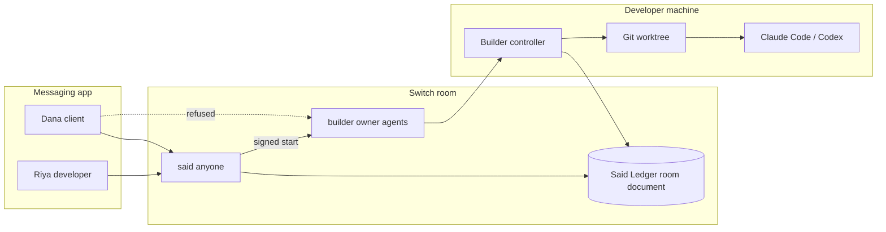

# Said

**Nothing starts until both people say yes.**

Said is a Switch agent that sits between a developer and a client. A request becomes a numbered draft. Work starts only when both enrolled people accept the same version and the same terms. The builder refuses ordinary chat. After the lock, Said sends a signed start token, and the builder re-checks the room ledger before Claude Code or Codex runs on the developer's machine.


| | |
| --- | --- |
| Demo video | https://youtu.be/1vA87efXzM8 |
| Write-up | https://atharvraotole.hashnode.dev/i-put-a-coding-agent-in-a-client-chat-and-taught-it-to-say-no |
| Site | https://said-switch.pages.dev |

Judges clone `main`. Submissions close November 7, 2026, 11:59 PM IST. Track: [Flip the Switch](https://www.wemakedevs.org/hackathons/switch), Best Business Workflow. Solo entry by Atharv Raotole. MIT license.

## What the demo shows

The video is a Telegram group that Switch bridges into one room. Riya is the developer and the owner of both agents. Dana is the client. The agents are `said` (anyone may address it) and `builder` (only the owner and that owner's agents).

1. Dana tells `@builder` to add dark mode. The builder refuses. Said logs **DRF-001**.
2. Riya sets the terms: `Terms DRF-001: +2 days, +$400`.
3. Riya accepts DRF-001 v1.
4. Dana says the dark mode was supposed to be free. Said quotes the signed ledger: the terms, who accepted, and who has not.
5. Dana accepts that same version. Said locks **AGR-001** and sends a signed start token to the builder.
6. The builder re-verifies the token and the ledger, then runs the worker in a clean git worktree, with typecheck and build gates.
7. Dana opens a second draft. It stays pending until Dana accepts it too.

On that Telegram recording the worker is Codex (`SAID_WORKER=codex`). The client-repo commit from the run is `c7fbb52`. That commit is on the machine that ran the demo. This repository does not contain it.

The screenshots further down are a separate capture: Switch 0.31.0 with Mattermost Team Edition, `SAID_WORKER=scripted`, job `JOB-AGR-001-1`, client commit `5dfc874`. The beat list is in [docs/LIVE_RUN.md](docs/LIVE_RUN.md). How to point the builder at Codex or Claude Code on a machine that is already logged in: [docs/REAL_WORKER.md](docs/REAL_WORKER.md). The same seven lines, typed by hand: [TESTING.md](TESTING.md).

## Switch is the mechanism



| Switch primitive | How Said uses it |
| --- | --- |
| Addressing | `said` is `anyone`. `builder` is `owner_and_owner_agents`. A client mention of the builder produces Switch's refusal in the channel. |
| Room document | The signed `Said Ledger` is a room document Said created. Switch rejects document writes from the builder. |
| Targeted message | After both accepts, Said sends a `said-start` token aimed at the builder. The builder reloads the ledger and checks the signature, both participant ids, the terms hash, the lock, and that the job is new. |

Those three are the product. Participant ids bind an accept to a person. The in-channel refusal stops a direct order to the builder. The creator-only document is the ledger. A webhook that only saw the chat text would start the job.

## Agents

| Agent | Switch name | Who can address it | What it does |
| --- | --- | --- | --- |
| Said | `said` | anyone | Logs scope, holds the signed ledger, quotes the record, sends the start token |
| Builder | `builder` | owner and that owner's agents | Refuses ordinary chat. Runs only after a signed start from Said, in a local git worktree |

Humans in the demo are Riya and Dana. They are people in the chat.

## Run it

Node `>=22.12` (`node -v`) and npm.

### Offline, from a clean clone

This path uses the mock Switch in the repo. The banner says so.

```bash
git clone https://github.com/AtharvRaotole/said-switch.git
cd said-switch
npm install
npm test
npm run demo:offline -- --script
```

`npm install` also installs the demo client site the first time tests or the offline demo need it. You should see the chat simulator, Said Console, and the client site. The script ends with AGR-001 locked and JOB-AGR-001-1 completed. Ctrl-C stops the processes.

### Telegram, the path in the video

Switch bridges the group. Said does not speak the Telegram Bot API. The bot token goes into Switch Console.

1. Install [Docker](https://docs.docker.com/get-docker/) and [Switch Console](https://github.com/sandbox-quantum/switch/releases/latest). In Console, **Add a server → Run a server on this computer**, and wait until the server is running.
2. In Telegram, open @BotFather and send `/newbot`. Keep the token and the bot username (the one that ends in `bot`).
3. In BotFather, send `/mybots`, open the bot, then **Bot Settings → Group Privacy → Turn off**. Do this before the bot joins any group. If the bot is already in a group, remove it and add it again after privacy is off.
4. In Switch Console, open **Home → Messaging apps → Connect → Telegram**. Name the connection, paste the bot token, and enter the bot username. Switch starts polling. A private chat with the bot is a different room.
5. Create a Telegram group, add Riya and Dana, and add the bot. Switch creates a room for that group. Copy the room id from Switch Console.
6. Each person posts one message in the group (a username is required). Then, in Switch Console, **Link my account** on the Telegram connection and pick **This is me**. Riya must link, so the builder treats Riya as its owner. Dana stays an unlinked client.
7. From the clone, fill `.env` with `SWITCH_URL` (the agent bridge URL whose `GET /health` returns 200), `SWITCH_REGISTRATION_KEY`, `SAID_ROOM_ID`, and `SAID_PLATFORM=telegram`. Then:

```bash
npm install
npm run setup
npm run register
```

8. In the group, invite both agents. Telegram has no @ autocomplete for agent names, so type the commands in full:

```text
!invite-agent @said
!invite-agent @builder
```

9. `npm run register` sets `said` to anyone and `builder` to owner and owner agents. If Console still shows another policy, set it there before you record. Then enroll and start. For the Codex path in the video, log in with `codex login` first and export `SAID_WORKER=codex` ([docs/REAL_WORKER.md](docs/REAL_WORKER.md)). The Mattermost capture used `SAID_WORKER=scripted`.

```bash
npm run enroll -- --developer "Riya" --client "Dana" --wait
# Video worker. Needs `codex login`. Use SAID_WORKER=scripted when you have no Codex login.
export SAID_WORKER=codex
npm run doctor
npm run dev
```

10. Each person sends `@said enroll <their code>` from their own Telegram account. Then follow [TESTING.md](TESTING.md). Mattermost instead of Telegram: [docs/SETUP_LIVE.md](docs/SETUP_LIVE.md).

On current Switch, Said's messages arrive at the builder with sender `@switch-agent-<8 hex>:<server>` and sender name `said`. The registration UUID is a different string. The builder accepts that transport id only together with the exact agent name. Leave `SAID_ALLOW_SAID_NAME_FALLBACK` unset on Telegram. Set it to `1` only for a Switch 0.31 Mattermost bridge, where the sender is a `@switch-mattermost-…` actor id. `npm run doctor` should be green before you record.

## What has to be true before work starts

- Only the two enrolled Switch participant ids can approve. Display names and quoted text do not count.
- An approval binds `(draftId, version, termsHash)`. A revision clears both approvals.
- A proposal is a new draft. A conditional yes does not lock anything.
- The builder re-verifies sender, signature, both distinct ids, matching terms, lock state, and that the job is new. A chat line alone does not start it.
- The worker runs in a disposable git worktree with path allow-lists, then typecheck and build.
- A missing or bad ledger stops Said. Said does not create a fresh empty book in its place.

Detail: [docs/SECURITY.md](docs/SECURITY.md). Other bridges Switch already supports: [docs/PLATFORM_BRIDGES.md](docs/PLATFORM_BRIDGES.md).

Verify a signed ledger or agreement receipt offline:

```bash
npm run verify -- path/to/ledger.md --public-key <base64>
# or
npm run verify -- path/to/ledger.md --public-key-file .said/public-keys.json
```

## Mattermost screenshots

Captured on the throwaway Switch 0.31.0 + Mattermost stack above (`SAID_WORKER=scripted`). Humans posted as `riya-dev` and `dana-client`.


## Site and console

```bash
npm -w @said/web run dev        # landing + playground on :7300
npm -w @said/console run dev    # read-only console on :7400
```

Static deploy (Cloudflare Pages or GitHub Pages): [docs/DEPLOY.md](docs/DEPLOY.md). The published site is https://said-switch.pages.dev.

## Checks

Measured with Node v22.23.4. `npm test` installs the demo client first, then runs every test. 0 skipped. The coverage percentages are the previous gated run. The new witness files sit outside that gate.

| Check | Result |
| --- | --- |
| `npm run lint` | exit 0, no findings |
| `npm run typecheck` | clean across workspaces |
| `npm test` | 35 files, 304 passed, 0 skipped |
| Statements / Branches / Functions / Lines | 92.95% / 81.11% / 95.27% / 96.12% |
| `@said/web` + `@said/console` production build | ok |
| `npm run demo:offline -- --script --headless` | story complete (AGR-001 locked, JOB-AGR-001-1 completed) |

Coverage is the gated set in `vitest.config.ts` (core, builder allowlist/authorize/exec, notary inbound, runtime http-auth). The landing-page Lighthouse capture in `docs/media/lighthouse/` is Performance 94, Accessibility 100, Best Practices 100, SEO 100.

```bash
npm test
npm run test:coverage
npm run lint
npm run typecheck
```

`npm run live:e2e` repeats the Mattermost story against a local throwaway Switch + Mattermost stack. Evidence: [docs/LIVE_RUN.md](docs/LIVE_RUN.md).

## Layout

TypeScript, Node `>=22.12`, npm workspaces. `@said/core` is the consent engine. The Switch client speaks the agent protocol over WebSocket. Web and console are React, Vite, and Tailwind v4. Tests are Vitest.

```
apps/notary          Said room loop and ledger HTTP API
apps/builder         Verify, run the worker, apply, receipt
apps/console         Read-only Said Console
apps/web             Landing site and in-browser playground
apps/witness         Read-only gateway for a separate demo Switch
apps/mock-switch     Offline Switch simulator
packages/core        Domain engine, crypto, ledger
packages/switch-client
packages/runtime
scripts/             setup, register, enroll, doctor, demo-offline
demo/                Client site fixture
docs/                Setup, design, security, live evidence
TESTING.md           Manual Telegram script
```

## Judging

| Criterion | Weight | Where to look |
| --- | --- | --- |
| Use of Switch | 30% | Addressing, the room document, and the targeted handoff in the diagram above. |
| Technical execution | 25% | Clean clone, `npm test`, `npm run demo:offline -- --script`, and [TESTING.md](TESTING.md) for the Telegram room. |
| Creativity and impact | 25% | Bilateral scope control for a coding agent in a shared channel, with a ledger quote when the deal is disputed. |
| Presentation | 20% | This page, the demo video, and the Hashnode write-up. |

## Hosted read-only demo

Public URL: pending. This is not a live judge URL. `/witness` says the host is pending until `VITE_SAID_WITNESS_URL` is set at build time. An internal-only room can show a gateway heartbeat and no ledger event. That is not the consent workflow.

The consent path uses the bundled Mattermost on that second stack. Official `deploy/shared_resources/setup.py` on tag `switch-v0.31.0` creates the admin and the first local user with `POST /api/v4/users`, then `POST /api/v4/users/login`. The same admin call creates another local user. No external login provider is required. `npm run demo:fixtures` creates `fixture-developer` and `fixture-client` on `http://127.0.0.1:8165` only. They are fixtures, not two people. `/witness` says that when the room name is `Said fixture demo`.

`npm run demo:fixtures -- --drive` posts the fixed lines with `POST /api/v4/posts` and returns only after the demo notary's own state contains AGR-001. It does not write the ledger. Docker runs the Switch stack. This environment has Python 3.12 and no Docker, so that stack was not executed here. A local HTTP test covers the Mattermost and notary calls.

The gateway reads only `http://127.0.0.1:8110/api/state`. It has no POST route. Any query string is refused. CORS allows one origin, default `https://said-switch.pages.dev`. Published fields are draft, accepts, lock, and a scripted work result. Ids must match a short token. Scope is capped at 180 characters and terms at 80. Participant ids, enrollment codes, raw chat, start tokens, keys, and error stacks are not published. Gateway check time and last ledger event time are different. A mock, a Codex or Claude worker, or the private room becomes source offline with no ledger fields.

Pins: Node `>=22.12`. Switch `0.31.0` (`ghcr.io/sandbox-quantum/switch-core:0.31.0`). Mattermost `mattermost/mattermost-team-edition:11.9.0`, the image that compose pins. Ports on `127.0.0.1`: Switch `8100`, Mattermost `8165`, notary `8110`, builder `8120`, gateway `8130`. Home `.said-demo`. Worker `scripted`.

```bash
export SAID_HOME=.said-demo
export SWITCH_URL=http://127.0.0.1:8100
export SWITCH_REGISTRATION_KEY=<registration key from the demo Gateway>
export SAID_WORKER=scripted
export SAID_PLATFORM=mattermost
export MATTERMOST_URL=http://127.0.0.1:8165
export MATTERMOST_ADMIN_USER=<demo admin>
export MATTERMOST_ADMIN_PASSWORD=<demo admin password>
export NOTARY_PORT=8110
export BUILDER_PORT=8120
npm run demo:fixtures
npm run register
export SAID_ROOM_ID=<demo room id>
export SAID_DEMO_ROOM_ID="$SAID_ROOM_ID"
npm run enroll -- --developer "Fixture developer" --client "Fixture client" --wait
npm run demo:services
npm run demo:fixtures -- --drive
npm run witness
```

Start the official standalone compose in its own directory, with `API_HOST_PORT=8100`, `MATTERMOST_HOST_PORT=8165`, `SWITCH_BIND_ADDR=127.0.0.1`, and a new compose project name. Do not reuse the current env, volumes, bot token, or Codex login. The seeded gateway admin creates a registration key with `POST /gateway/api-keys` after `POST /gateway/auth/login`. `npm run demo:room` remains the internal-only room and does not produce a consent record. The public hostname stays pending until a tunnel is attached to `127.0.0.1:8130`.

## License

MIT. Atharv Raotole.
