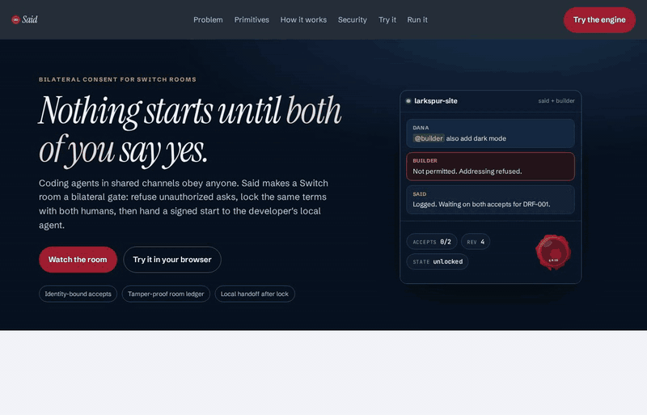
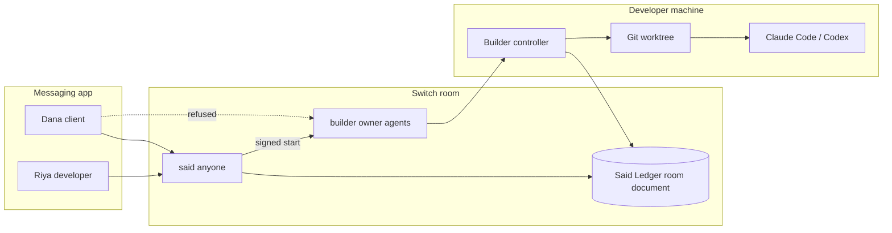
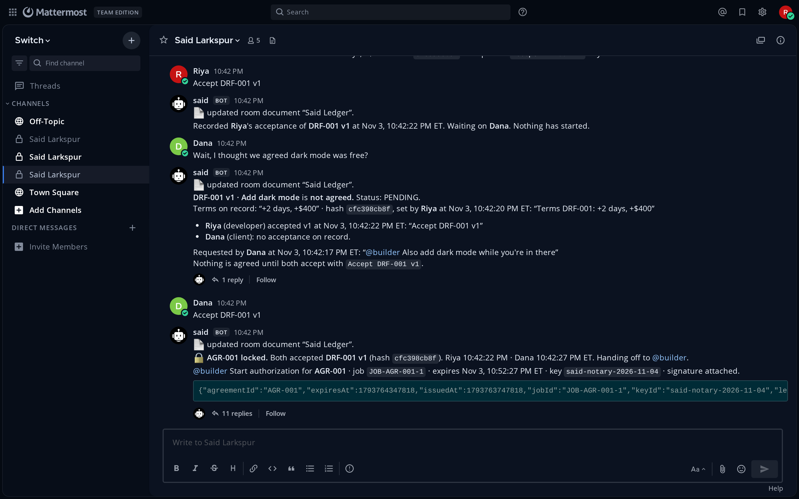
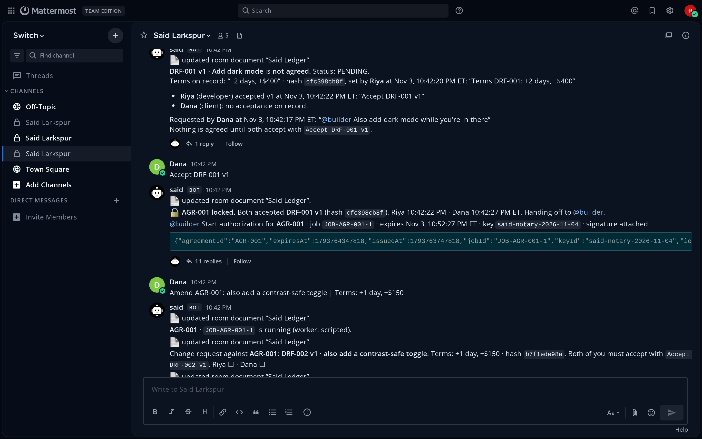
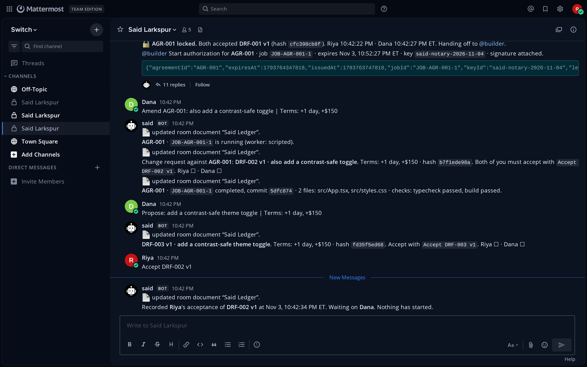

# Said

**Nothing starts until both people say yes.**

Said turns any Switch room into a bilateral execution gatekeeper for AI coding agents. Unauthorized instructions get a visible refusal. Work cannot start until both enrolled humans accept the same terms. Disputes are settled with a timestamped quote from a tamper-proof room ledger. Accepted scope triggers an authenticated handoff into the developer's local terminal (Claude Code or Codex).



> Live Mattermost UI evidence (real Switch 0.31.0 bridge): [docs/LIVE_RUN.md](docs/LIVE_RUN.md). Demo video: record from the same room before the Nov 7 deadline.

## Why it matters

When teams bring coding agents into shared Slack, Teams, Discord, or Mattermost channels, every agent suffers from blind obedience. "Also add dark mode while you are in there" either starts unpaid work immediately, or burns an hour of "I thought we agreed" on Monday.

Existing chat bots cannot solve this. They lack identity-enforced addressing, agent-owned room state, and authenticated agent-to-agent handoffs into a local coding terminal.

## The remove-Switch test

Take Switch away and Said stops being a product:

1. **No participant id** to bind an accept to. Display names are not identities.
2. **No visible addressing refusal.** A client could command the builder directly.
3. **No room document** that only Said can write. The ledger would be an external database anyone can edit.
4. **No authenticated targeted handoff** the builder can re-verify before touching git.

A webhook chatbot would just start the job. Said exists because Switch makes those four primitives real.

## Architecture



| Primitive | Switch feature | What Said does with it |
| --- | --- | --- |
| Addressing boundaries | Agent `addressing` modes | `said` = anyone. `builder` = owner and owner agents. Client mention produces Switch's refusal in-channel. |
| Agent-owned state | Room documents | Signed `Said Ledger` revisions. Only Said can update. Console verifies Ed25519 in the browser. |
| Authenticated handoff | Agent registration + WebSocket sessions + targeted messages | After both accepts, Said sends a signed start token aimed at the builder. Builder reloads the ledger and re-checks before any worker runs. |

## Quickstart (offline, under 2 minutes)

This path is a **labeled simulation**. It does **not** talk to Switch. Use it to see the consent path, console, and client site change without installing Switch Console.

```bash
git clone https://github.com/AtharvRaotole/said-switch.git
cd said-switch
npm install
npm run demo:offline -- --script
```

You should see a banner that says this is not Switch, plus URLs for the chat simulator, Said Console, and the client site. Ctrl-C stops everything.

Prove the engine without the UI:

```bash
npm test
npm run typecheck
```

## Live Switch setup

For a real Mattermost room with Switch Console:

1. Follow [docs/SETUP_LIVE.md](docs/SETUP_LIVE.md) (Docker, Switch Console, registration key, room id).
2. Then:

```bash
npm install
npm run setup
npm run register
npm run enroll -- --developer "Riya" --client "Dana" --wait
npm run doctor
npm run dev
```

`npm run doctor` should be green before you record.

## Security model (summary)

- Only the two enrolled Switch participant ids can approve. Display names and quoted text never count.
- An approval binds `(draftId, version, termsHash)`. Any revision clears both approvals.
- A proposal is not an approval. Conditional yes does not count.
- The builder never starts on a chat message alone. It re-verifies sender, signature, both distinct ids, matching terms, lock state, and that the job is not already done.
- The coding worker runs in a disposable git worktree with path allow-lists, typecheck, and build gates.
- Missing or tampered ledger: fail closed. Said does not silently recreate an empty book.

Full write-up: [docs/SECURITY.md](docs/SECURITY.md). Live operations notes: [docs/LIVE_RUN.md](docs/LIVE_RUN.md). Platform bridges (Slack, Telegram, Mattermost via Switch): [docs/PLATFORM_BRIDGES.md](docs/PLATFORM_BRIDGES.md).

Verify a signed ledger or agreement receipt offline:

```bash
npx said verify path/to/ledger.md --public-key <base64>
# or
npm run verify -- path/to/ledger.md --public-key-file .said/said.pub
```

## Live on real Switch

Captured against Switch 0.31.0 + Mattermost Team Edition on a throwaway local stack. Humans posted as `riya-dev` (Riya) and `dana-client` (Dana). Full beat list, ledger ids, and CLI steps: [docs/LIVE_RUN.md](docs/LIVE_RUN.md).







## Marketing site and console

```bash
npm -w @said/web run dev        # landing + playground on :7300
npm -w @said/console run dev    # read-only console on :7400
```

Static deploy steps (Cloudflare Pages or GitHub Pages): [docs/DEPLOY.md](docs/DEPLOY.md).

## Tests and coverage

Measured on this tree (`release/submit`) after `npm ci`:

| Check | Result |
| --- | --- |
| `npm run lint` | 0 errors, 0 warnings |
| `npm run typecheck` | clean across workspaces |
| `npm test` (with coverage) | 25 files, 245 passed |
| Statements / Branches / Functions / Lines | 92.84% / 80.78% / 95.21% / 96.17% |
| `@said/web` + `@said/console` production build | ok |
| `npm run demo:offline -- --script` | story complete (AGR locked, JOB completed) |
| Landing Lighthouse (web stream, production build) | Performance 94, Accessibility 100, Best Practices 100, SEO 100 |

```bash
npm test
npm run test:coverage
npm run lint
npm run typecheck
```

Reproduce the live Mattermost story against a local throwaway Switch + Mattermost stack:

```bash
npm run live:e2e
```

Evidence and UI screenshots: [docs/LIVE_RUN.md](docs/LIVE_RUN.md).

## Tech stack

- TypeScript, Node `>=22.12`, npm workspaces
- `@said/core` pure consent engine (isomorphic)
- Switch agent protocol client (WebSocket)
- React + Vite + Tailwind v4 for web and console
- Self-hosted fonts, navy and wax-seal brand
- Vitest for unit and integration tests
- Offline mock Switch server for judge reproduction

## Project structure

```
apps/notary          Said room event loop and ledger HTTP API
apps/builder         Local controller: verify, run worker, apply, receipt
apps/console         Read-only Said Console
apps/web             Landing site, animated hero, in-browser playground
apps/mock-switch     Offline Switch protocol simulator
packages/core        Domain engine, crypto, ledger
packages/switch-client
packages/runtime
packages/brand
scripts/             setup, register, enroll, doctor, demo-offline
templates/           Switch room template(s)
docs/                Setup, design, deploy, security
demo/                Client site fixture and patches
```

## Track and judging

Built for [Flip the Switch](https://www.wemakedevs.org/hackathons/switch) (WeMakeDevs), primary track **Best Business Workflow**.

Judging weights: Switch usage 30%, technical execution 25%, creativity and impact 25%, presentation 20% (demo video + README clarity).

## Team

Atharv Raotole

## License

MIT
