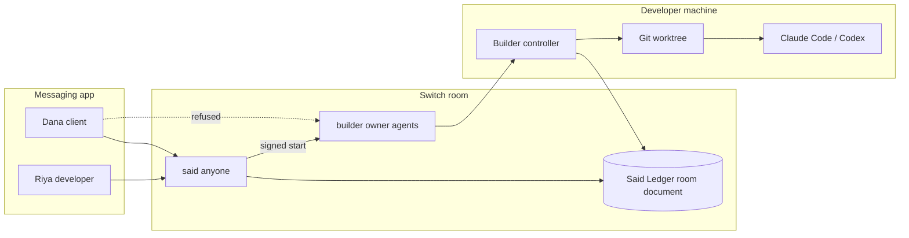

# Said

**Nothing starts until both people say yes.**

Said turns any Switch room into a bilateral execution gatekeeper for AI coding agents. Unauthorized instructions get a visible refusal. Work cannot start until both enrolled humans accept the same terms. Disputes are settled with a timestamped quote from a tamper-proof room ledger. Accepted scope triggers an authenticated handoff into the developer's local terminal (Claude Code or Codex).


Live Mattermost UI evidence (real Switch 0.31.0 bridge): [docs/LIVE_RUN.md](docs/LIVE_RUN.md). Marketing site: [https://said-switch.pages.dev](https://said-switch.pages.dev).

**Demo video:** PASTE_DEMO_VIDEO_URL

Replace `PASTE_DEMO_VIDEO_URL` with the link to the Telegram walkthrough before you submit. Submissions close November 7, 2026, 11:59 PM IST. Do not leave the placeholder in the form.

## Why it matters

When teams bring coding agents into shared Slack, Teams, Discord, or Mattermost channels, every agent suffers from blind obedience. "Also add dark mode while you are in there" either starts unpaid work immediately, or burns an hour of "I thought we agreed" on Monday.

Existing chat bots cannot solve this. They lack identity-enforced addressing, agent-owned room state, and authenticated agent-to-agent handoffs into a local coding terminal.

## The remove-Switch test

Take Switch away and Said stops being a product:

1. **No participant id** to bind an accept to. Display names are not identities.
2. **No visible addressing refusal.** A client could command the builder directly.
3. **No room document** that only Said can write. The ledger would be an external database anyone can edit.
4. **No authenticated targeted handoff** the builder can re-verify before touching git.

A webhook chatbot would just start the job. Said exists because Switch makes those four primitives real.

## Architecture



| Primitive | Switch feature | What Said does with it |
| --- | --- | --- |
| Addressing boundaries | Agent `addressing` modes | `said` = anyone. `builder` = owner and owner agents. Client mention produces Switch's refusal in-channel. |
| Agent-owned state | Room documents | Signed `Said Ledger` revisions. Only Said can update. Console verifies Ed25519 in the browser. |
| Authenticated handoff | Agent registration + WebSocket sessions + targeted messages | After both accepts, Said sends a signed start token aimed at the builder. Builder reloads the ledger and re-checks before any worker runs. |

## Agents

Said registers two Switch agents. Nothing else joins the room as an agent.

| Agent | Switch name | Who can address it | What it does |
| --- | --- | --- | --- |
| Said | `said` | anyone | Logs scope changes, holds the signed ledger, quotes the record, sends the start token |
| Builder | `builder` | owner and that owner's agents | Refuses ordinary chat. Runs only after a signed start from Said, in a local git worktree |

Humans in the demo are Riya (developer, owner of both agents) and Dana (client). They are people in the chat, not agents.

## Quickstart from a clean clone

Needs Node `>=22.12` (`node -v`) and npm. This path does **not** talk to Switch. The banner says so.

```bash
git clone https://github.com/AtharvRaotole/said-switch.git
cd said-switch
npm install
npm test
npm run typecheck
npm run lint
npm run demo:offline -- --script
```

`npm install` also installs the demo client site the first time the tests or the offline demo need it. You should see the chat simulator, Said Console, and the client site. The scripted story ends with AGR-001 locked and JOB-AGR-001-1 completed. Ctrl-C stops the processes.

## Live Telegram room

Switch bridges the group. Said does not speak the Telegram Bot API. The bot token goes into Switch Console, never into this repo.

1. Install [Docker](https://docs.docker.com/get-docker/) and [Switch Console](https://github.com/sandbox-quantum/switch/releases/latest). In Console, **Add a server → Run a server on this computer**, and wait until it says the server is running.
2. In Telegram, open @BotFather and send `/newbot`. Save the token and the bot username (the one that ends in `bot`).
3. In BotFather, send `/mybots`, open the bot, then **Bot Settings → Group Privacy → Turn off**. Do this **before** the bot joins any group. If the bot is already in the group, remove it and add it again after privacy is off.
4. In Switch Console, open the server **Home → Messaging apps → Connect → Telegram**. Name the connection, paste the bot token, and enter the bot username. Switch starts polling. A private chat with the bot is not a room.
5. In Telegram, create a group, add Riya and Dana, and add the bot. Switch creates a room for that group. Copy the room id from Switch Console.
6. Each person posts one message in the group (a username is required; a phone number is not enough). Then, in Switch Console, **Link my account** on the Telegram connection and pick **This is me**. Riya must link, or the builder will not treat Riya as its owner. Dana stays an unlinked client.
7. From a clean clone, with `.env` filled in (`SWITCH_URL` is the agent bridge URL whose `GET /health` returns 200, plus `SWITCH_REGISTRATION_KEY` and `SAID_ROOM_ID`):

```bash
npm install
npm run setup
npm run register
```

8. In the group, invite both agents. Telegram has no @ autocomplete for agent names, so type the commands in full:

```text
!invite-agent @said
!invite-agent @builder
```

9. Enroll, check, and start. `npm run register` sets `said` to anyone and `builder` to owner and owner agents. If Console still shows the wrong policy, set it there before you record.

```bash
npm run enroll -- --developer "Riya" --client "Dana" --wait
npm run doctor
npm run dev
```

10. Each person sends `@said enroll <their code>` from their own Telegram account. The manual script is [TESTING.md](TESTING.md). Mattermost instead of Telegram: [docs/SETUP_LIVE.md](docs/SETUP_LIVE.md).

On current Switch, Said's messages arrive at the builder with sender `@switch-agent-<8 hex>:<server>` and sender name `said`, not the registration UUID. The builder accepts that transport id only together with the exact agent name. A Telegram user cannot pass by renaming themselves. Leave `SAID_ALLOW_SAID_NAME_FALLBACK` unset for Telegram. Set it to `1` only for a Switch 0.31 Mattermost bridge, where the sender is a `@switch-mattermost-…` actor id.

`npm run doctor` should be green before you record.

## Security model (summary)

- Only the two enrolled Switch participant ids can approve. Display names and quoted text never count.
- An approval binds `(draftId, version, termsHash)`. Any revision clears both approvals.
- A proposal is not an approval. Conditional yes does not count.
- The builder never starts on a chat message alone. It re-verifies sender, signature, both distinct ids, matching terms, lock state, and that the job is not already done.
- The coding worker runs in a disposable git worktree with path allow-lists, typecheck, and build gates.
- Missing or tampered ledger: fail closed. Said does not silently recreate an empty book.

Full write-up: [docs/SECURITY.md](docs/SECURITY.md). Live operations notes: [docs/LIVE_RUN.md](docs/LIVE_RUN.md). Platform bridges (Slack, Telegram, Mattermost via Switch): [docs/PLATFORM_BRIDGES.md](docs/PLATFORM_BRIDGES.md).

Verify a signed ledger or agreement receipt offline:

```bash
npm run verify -- path/to/ledger.md --public-key <base64>
# or
npm run verify -- path/to/ledger.md --public-key-file .said/public-keys.json
```

## Live on real Switch

Captured against Switch 0.31.0 + Mattermost Team Edition on a throwaway local stack. Humans posted as `riya-dev` (Riya) and `dana-client` (Dana). Full beat list, ledger ids, and CLI steps: [docs/LIVE_RUN.md](docs/LIVE_RUN.md).


## Marketing site and console

```bash
npm -w @said/web run dev        # landing + playground on :7300
npm -w @said/console run dev    # read-only console on :7400
```

Static deploy steps (Cloudflare Pages or GitHub Pages): [docs/DEPLOY.md](docs/DEPLOY.md).

## Tests and coverage

Measured on branch `cursor/telegram-said-sender-6d19` after a fresh `npm install` (Node v22.23.4), then `npm run ensure:demo-client` so the offline end-to-end test is not skipped:

| Check | Result |
| --- | --- |
| `npm run lint` | exit 0, no findings |
| `npm run typecheck` | clean across workspaces |
| `npm run test:coverage` | 31 files, 279 passed |
| Statements / Branches / Functions / Lines | 92.95% / 81.11% / 95.27% / 96.12% |
| `@said/web` + `@said/console` production build | ok |
| `npm run demo:offline -- --script --headless` | story complete (AGR-001 locked, JOB-AGR-001-1 completed, `src/App.tsx` and `src/styles.css`) |

Coverage is the gated set in `vitest.config.ts` (core, builder allowlist/authorize/exec, notary inbound, runtime http-auth). An earlier Lighthouse run of the landing page is in `docs/media/lighthouse/` (Performance 94, Accessibility 100, Best Practices 100, SEO 100). That page was not re-measured for this branch.

```bash
npm test
npm run test:coverage
npm run lint
npm run typecheck
```

Reproduce the live Mattermost story against a local throwaway Switch + Mattermost stack:

```bash
npm run live:e2e
```

Evidence and UI screenshots: [docs/LIVE_RUN.md](docs/LIVE_RUN.md).

## Tech stack

- TypeScript, Node `>=22.12`, npm workspaces
- `@said/core` pure consent engine (isomorphic)
- Switch agent protocol client (WebSocket)
- React + Vite + Tailwind v4 for web and console
- Self-hosted fonts, navy and wax-seal brand
- Vitest for unit and integration tests
- Offline mock Switch server for judge reproduction

## Project structure

```
apps/notary          Said room event loop and ledger HTTP API
apps/builder         Local controller: verify, run worker, apply, receipt
apps/console         Read-only Said Console
apps/web             Landing site, animated hero, in-browser playground
apps/mock-switch     Offline Switch protocol simulator
packages/core        Domain engine, crypto, ledger
packages/switch-client
packages/runtime
packages/brand
scripts/             setup, register, enroll, doctor, demo-offline
templates/           Switch room template(s)
docs/                Setup, design, deploy, security
TESTING.md           Manual Telegram script for the owner
demo/                Client site fixture and patches
```

## Track and judging

Built for [Flip the Switch](https://www.wemakedevs.org/hackathons/switch) (WeMakeDevs × DevTools Academy × Switch), primary track **Best Business Workflow**. Submissions close November 7, 2026, 11:59 PM IST. Solo entry.

| Criterion | Weight | What to look at |
| --- | --- | --- |
| Use of Switch | 30% | Addressing, the room document, and the targeted handoff. Said stops working if those are removed. |
| Technical execution | 25% | `npm install` on a clean clone, `npm test`, `npm run demo:offline -- --script`, and [TESTING.md](TESTING.md) for the live Telegram room. |
| Creativity and impact | 25% | Bilateral scope control for a coding agent in a shared channel, with a quote from the signed ledger when someone disputes the deal. |
| Presentation | 20% | This README plus the demo video. The video line at the top is a placeholder until the recording is linked. |

## Team

Atharv Raotole

## License

MIT
